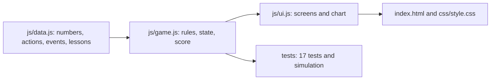
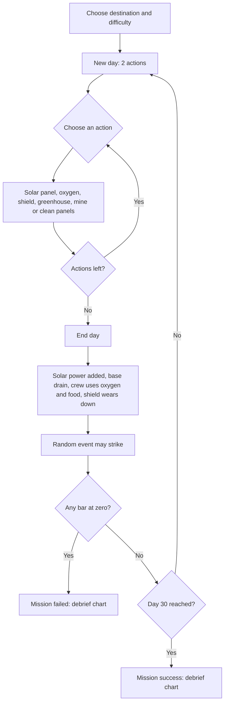

# LunaWolf: Outpost Commander

Team **lunaWolf** | NASA Space Apps Challenge 2026
Challenge: **Build a Junior Astronaut Mission Trainer**

An interactive browser game where students run a lunar or Martian outpost for 30 days. They balance **oxygen, power, radiation shielding and food**, and learn why each trade-off matters. After every action or event the game explains why it happened.

## Play

Open `index.html` in any browser (desktop or phone). No install, no account, no internet needed after the page loads.

## Features

- Two destinations with different physics: the **Moon** (long lunar night, no solar power) and **Mars** (weak sunlight, dust storm season, no resupply).
- Three difficulty levels: Cadet, Commander, Mission Director.
- Mission control **forecast** that teaches planning ahead.
- Six actions with real costs: solar panels, oxygen generator, regolith shielding, greenhouse, mining, panel cleaning.
- Five random events, including solar flares whose damage depends on your shielding.
- A **"Why" note** after every action and event.
- **Mission debrief**: a chart of all four resources over time, plus a lesson tied to the way the mission ended.
- Score with a difficulty bonus and best scores saved in the browser.
- Mobile friendly, keyboard usable buttons, screen-reader friendly log.

## Learning goals

1. Space systems are coupled: oxygen, food and shielding all depend on power.
2. Planning beats reacting: the lunar night and dust storm season can be forecast.
3. Resources are limited, so every action has an opportunity cost.
4. Local resources (regolith, ice) reduce dependence on Earth.

## Project structure

```
lunawolf/
├── index.html         page layout
├── css/style.css      styling
├── js/data.js         numbers, actions, events, lesson text
├── js/game.js         game rules, state, scoring, forecast
├── js/ui.js           screens, chart drawing, start/end/help
├── tests/load.js      loads the game logic for testing, plus two bot players
├── tests/run-tests.js 17 automated tests
├── tests/simulate.js  balance simulation
├── package.json       npm scripts
└── README.md
```

The rules (`game.js`) are separate from the screen code (`ui.js`), so the same logic runs in the browser and in Node for testing.

## Architecture

The game is a static web page with no server and no framework. Three plain JavaScript files load in order: data, then rules, then screens.



| Layer | File | Responsibility |
| --- | --- | --- |
| Data | `js/data.js` | Constants, difficulty levels, destinations, actions, random events and lesson text. Change numbers here to tune the game. |
| Logic | `js/game.js` | Game state, daily update, event roll, win and lose checks, forecast, score, best scores in browser storage. |
| Interface | `js/ui.js` | Draws bars, buttons, log and forecast, the start, help and end screens, and the debrief chart on a canvas. |
| Page | `index.html`, `css/style.css` | Layout and styling. Works on phones and desktops. |
| Tests | `tests/` | Loads the data and logic files in Node, runs 17 checks, and simulates thousands of games with two bot players. |

How one day works:



Design decisions:

- **No frameworks or build step.** The page opens straight from a file or GitHub Pages, so teachers and students need nothing installed.
- **Data separated from logic.** Educators can edit numbers and lesson text in one file without touching the rules.
- **Logic separated from the screen.** The same rules run in Node, which makes automated testing and balance simulation possible.
- **Seeded random numbers in tests.** Simulations are repeatable.

## Game model

| Item | Value |
| --- | --- |
| Length | 30 days, 2 actions per day |
| Daily drain (Commander) | oxygen -5, food -5, shield -3 (Moon) or -2 (Mars), base power -6 |
| Solar output | panels x 3 (Moon) or x 2 (Mars) per day |
| Lunar night | days 13 to 17, solar output 0 |
| Mars storm season | days 14 to 20, solar output 20% |
| Dust storm event | solar output 30% for 3 days, cleaning removes it |
| Event chance per day | 30% / 40% / 50% by difficulty, from day 3 |

Values are simplified teaching numbers and game time is shortened. They are not real mission data.

## Testing and validation

```
npm test            runs 17 automated tests (Node.js, no packages needed)
npm run simulate    plays thousands of seeded games and prints win rates
```

The simulation uses two automated players: a "planning bot" that watches its bars and prepares for the lunar night, and a "random bot" that picks actions at random. Results from 1000 seeded games per row:

| Site | Difficulty | Planning bot wins | Random bot wins |
| --- | --- | --- | --- |
| Moon | Cadet | 97.1% | 7.8% |
| Moon | Commander | 85.9% | 2.4% |
| Moon | Director | 55.3% | 0.7% |
| Mars | Cadet | 96.8% | 0.4% |
| Mars | Commander | 81.4% | 0.0% |
| Mars | Director | 37.8% | 0.0% |

Random play almost never survives and careful planning usually does, so choices matter. The harder levels are meaningfully harder.

## NASA data and resources used

- NASA Moon Facts (science.nasa.gov/moon/facts): the lunar night lasts about 14 Earth days and there is no thick atmosphere. This inspired the lunar night phase with no solar power and the radiation shield mechanic.
- NASA, "The Fact and Fiction of Martian Dust Storms" (nasa.gov): dust storms reduce sunlight reaching solar panels. This inspired the Mars storm season and the random dust storm event.

## Limitations and future work

- Simplified model: no crew members, temperature, water or battery capacity.
- Content is in English only and there is no teacher dashboard.
- Next steps: crew health, a water system, classroom score sharing, and more languages.

## Use of AI

The code and documentation were written with AI assistance (Claude by Anthropic). The team reviewed, tested and customized the result. No AI-generated images or audio are used. This project is not affiliated with or endorsed by NASA and uses no NASA logos.
